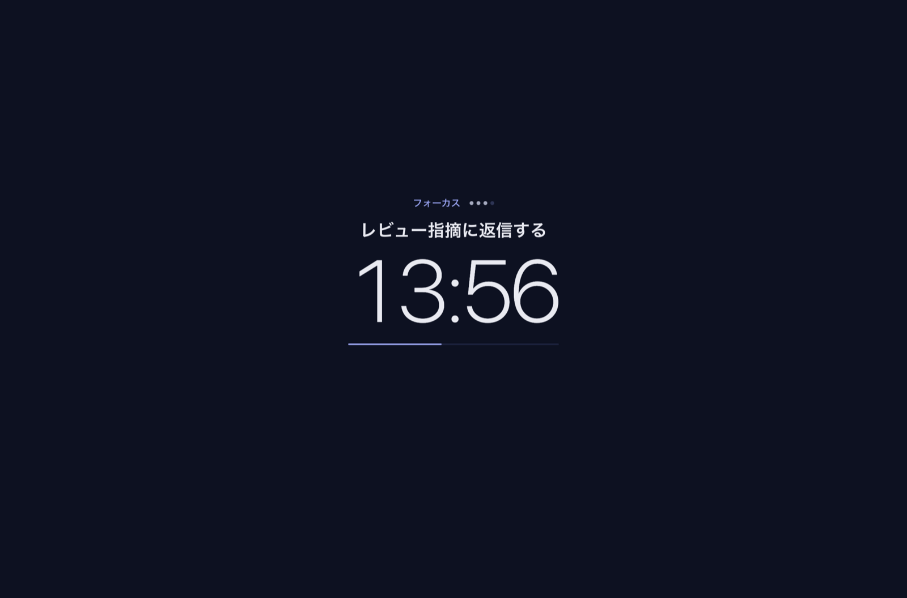

# Pomodoro Atelier

ひとつのことに集中するための、タスクとタイマーのデスクトップアプリ(macOS / Windows / Linux)。

タスクを選んで始めると、画面が深い色に沈み、周りが退きます。使った時間は区間として正直に残り、その日のうちにふりかえれます。



紹介ページは [anieca.github.io/pomodoro-timer](https://anieca.github.io/pomodoro-timer/)、版ごとの変更は [リリース](https://github.com/Anieca/pomodoro-timer/releases)。

## インストール

macOS と Linux は、次の一行で最新版を入れられます(更新も同じ)。

```bash
curl -fsSL https://raw.githubusercontent.com/Anieca/pomodoro-timer/main/scripts/install.sh | bash
```

- macOS: `/Applications` に置いて起動します。署名していないアプリのため、開けるようにダウンロードの印を外します。記録には触れません。
- Linux: AppImage を `~/.local/bin/pomodoro-atelier` に置きます。
- Windows: [リリースページ](https://github.com/Anieca/pomodoro-timer/releases/latest)のインストーラ(.exe)を使ってください。

以前のバージョン(1.x)のデータは、初回の起動で引き継ぎます。

## できること

- **いま** — 向き合うタスク、残り時間と経過の線、今日の帯を一画面に。タイマーを止めずにタスクを切り替えられ、一時停止やスリープの間は実働に数えません。
- **ふりかえり** — 一日の帯と記録、直近 7 / 30 / 90 日の傾向。
- **ウィンドウを閉じても** — メニューバーの残り時間、ミニタイマー、通知とチャイム、環境音。
- **データは手元に** — ローカルに保存。JSON / CSV で書き出し、JSON から読み込み。

キー操作: `Space` 開始/一時停止、`N` タスクを足す、`⌘1` いま、`⌘2` ふりかえり、`⌘,` 設定。

## 開発

[docs/DEVELOPMENT.md](docs/DEVELOPMENT.md)(構成・テスト・リリースの手順)と [docs/DESIGN.md](docs/DESIGN.md)(デザインの理由)。

## ライセンス

[MIT](LICENSE)
